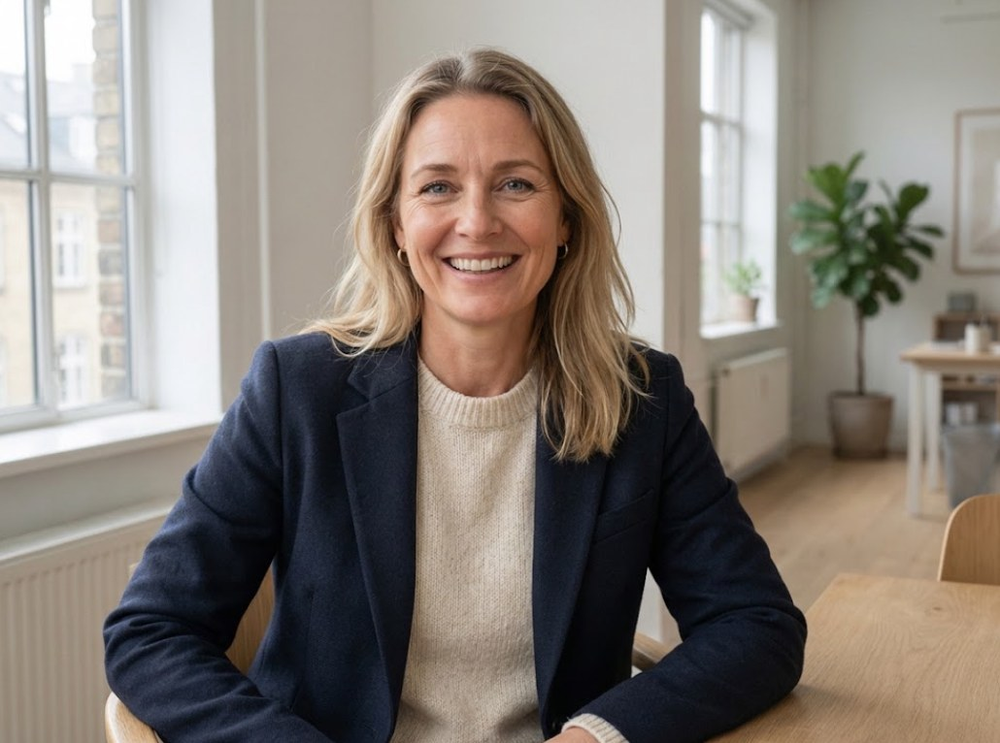

# Sammen personas

The demo tells one story: Mette (investor) is matched with Sofie (founder) and they meet for a coffee.

## Mette, 46 – Business angel, Copenhagen

**Who she is**
Sold her own company. Now invests her own money in early-stage startups, any sector. No team, no analyst: she screens every founder herself.

**Core problem**
She has money to invest but not enough good ideas reach her.

**How she finds founders today**
- Pitch events and demo days: lots of time, the same faces
- LinkedIn inbound: cold messages, mostly irrelevant
- Intros from friends: good, but limited to her own circle
- Angel network meetings: curated, but few deals and only local

**What frustrates her**
Too much noise. Stuck in her own network. Can't trust profiles. No time.

**What makes her trust a profile**
Verified identity, verified business email, verified company or track record, a mutual contact who vouches, a short video introduction.

**What she wants from Sammen**
Three verified founders a week who fit what she is looking for, each with one line on why they should meet, and a coffee booked in one click.

**Her sentence in the demo**
"I back first-time founders in Europe who already have a working product and need their first cheque."

## Sofie, 29 – Technical founder, first startup

**Who she is**
Built her MVP herself. It works and has first users. She has never raised money and knows no investors.

**What she is looking for**
1. Her first cheque
2. A business co-founder

**Core problem**
She can build, but she is outside the circles where investors and business people meet. Cold messages to investors go unanswered.

**What frustrates her**
Events cost time she needs for building. She can't tell which investors are serious. Co-founder platforms are full of profiles she can't verify.

**What she wants from Sammen**
A few people who are right for her, verified, and a real conversation over coffee instead of another pitch deck sent into the void.

**Her sentence in the demo**
"I have a working product and first users. I need my first investor and a business co-founder."

## Demo journey (about 90 seconds)

1. Mette signs up, gets verified, says what she is looking for in one sentence.
2. Sammen shows her three matched founders, not a feed.
3. She opens Sofie: the AI explains why they fit.
4. Both say yes, and the coffee is booked (in person or video).
5. Closing line: from idea to coffee in two minutes, all European, all verified.

